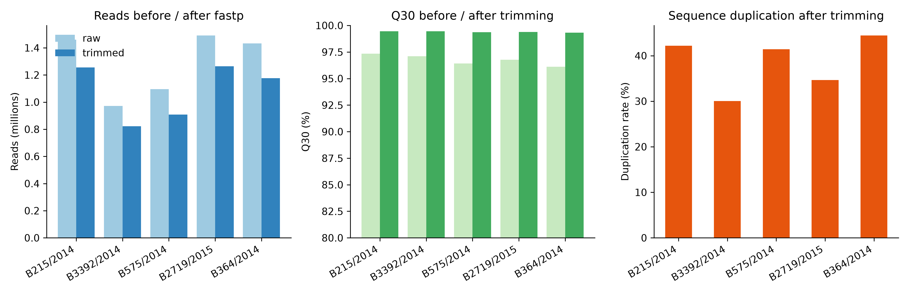
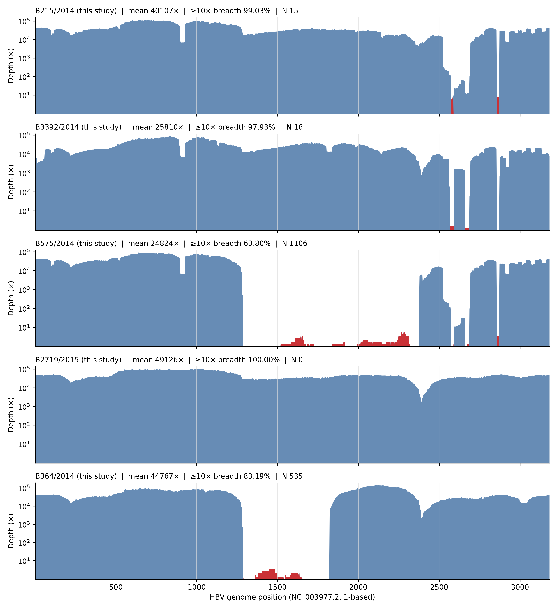
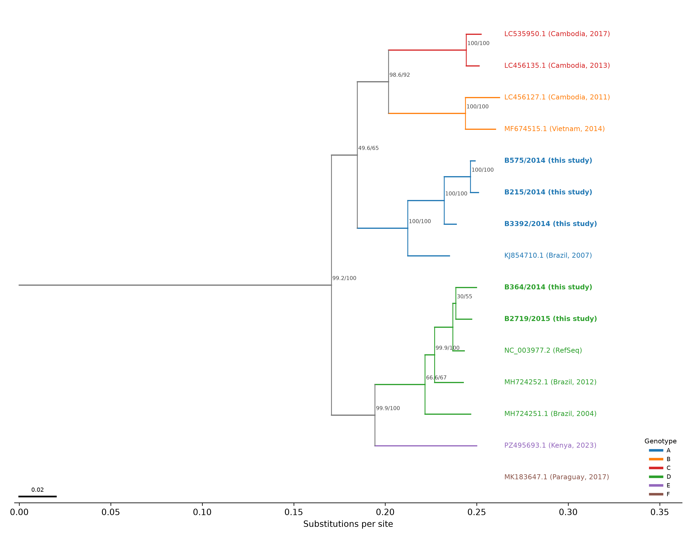
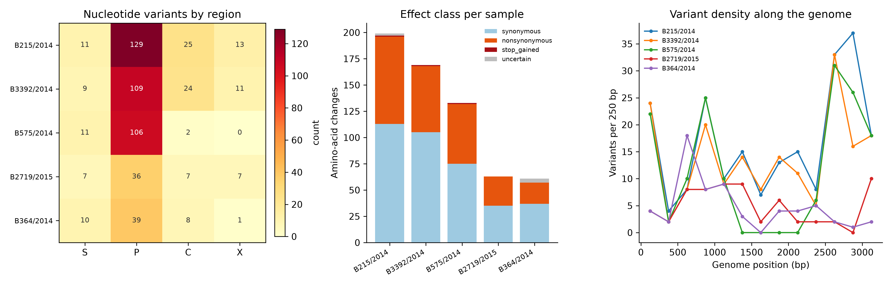
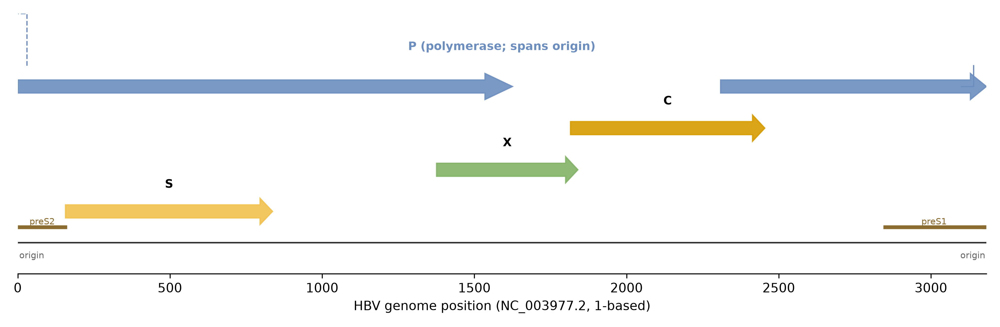

# From raw reads to a maximum-likelihood tree: a reproducible HBV whole-genome workflow

Hepatitis B virus (HBV) is a small, partially double-stranded DNA virus with a
~3.2 kb circular genome. Whole-genome sequencing (WGS) is useful for genotype
assignment, phylogenetic placement and description of coding variation, but the
genome is not a conventional linear bacterial or human reference: the origin is
arbitrary, the polymerase and surface genes overlap, and recombination is common.
Those features make a naïve “map, call a consensus, align, build a tree” pipeline
easy to run and easy to misinterpret.

This post documents a small, reproducible HBV demonstration analysis on
OmicsLab. It uses five Illumina paired-end runs from a Brazilian HBV cohort and
ten complete public genomes from GenBank. The goal is methodological: show the
actual commands, outputs and caveats, not to make epidemiological or clinical
claims from a five-sample dataset.

## 1. The data

The five runs come from NCBI BioProject **PRJNA659786** (study SRP279096),
“New method for next generation sequencing of the hepatitis B virus full genome.”
All are Illumina MiSeq paired-end libraries from Brazil. The project contains 16
runs annotated as genotype A or D; for this demonstration I selected the three
genotype A and two genotype D runs with the highest read counts, giving a small
balanced panel rather than an arbitrary subset.

| Sample | Run | Genotype | Collection date | Raw read pairs |
|---|---|---|---|---:|
| B215/2014 | SRR12535947 | A | 2014-04-15 | 729,656 |
| B575/2014 | SRR12535935 | A | 2014-11-04 | 548,145 |
| B3392/2014 | SRR12535942 | A | 2014-10-03 | 485,550 |
| B2719/2015 | SRR12535933 | D | 2014-01-28 | 745,196 |
| B364/2014 | SRR12535938 | D | 2014-07-03 | 716,362 |

The raw FASTQ files were downloaded from OmicsLab storage and checked against
the ENA/SRA MD5 values before analysis. The five pairs are 0.8–1.3 million reads
each, which is far more than needed for a 3.2 kb genome; the high depth is useful
for detecting low-frequency variation, but it also means that mapping artefacts
can look statistically impressive.

### Public reference panel

Ten complete HBV genomes were selected from GenBank with E-utilities. The panel
is deliberately small and curated. It includes two genotype A and three genotype
D genomes because the study samples are A/D; two genotype B and two genotype C
genomes from Vietnam/Cambodia for Southeast Asian context; and one E and one F
genome as outgroups:

| Accession | Genotype | Country | Date | Length (bp) | Role |
|---|---|---|---:|---:|---|
| NC_003977.2 | D | not available | not available | 3,182 | RefSeq mapping reference (strain ayw) |
| KJ854710.1 | A2 | Brazil | 2007 | 3,221 | Brazilian A |
| MF674515.1 | B4 | Vietnam | 2014-06-19 | 3,215 | Vietnam B |
| LC456127.1 | B2 | Cambodia | 2011 | 3,215 | Cambodia B |
| LC456135.1 | C1 | Cambodia | 2013 | 3,215 | Cambodia C |
| LC535950.1 | C1 | Cambodia | 2017 | 3,215 | Cambodia C |
| MH724251.1 | D4 | Brazil | 2004 | 3,182 | Brazilian D |
| MH724252.1 | D1 | Brazil | 2012 | 3,182 | Brazilian D |
| PZ495693.1 | E | Kenya | 2023 | 3,212 | Outgroup |
| MK183647.1 | F4 | Paraguay | 2017 | 3,215 | Outgroup |

Every record is a complete genome of 3,182–3,221 bp with <0.1% ambiguous bases.
Accessions are unique, and the panel is saved with country, date, genotype,
sequence length and retrieval manifest in `references/hbv_metadata.tsv` and
`references/fetch_manifest.json`.

A detail that matters: **NC_003977.2 is genotype D**, not genotype A. The strain
is the ayw reference, and genotype D is the expected context for ayw. This was
confirmed by pairwise identity: NC_003977.2 is ~96–97% identical to the Brazilian
D genomes and ~91% identical to the genotype A2 genome. The mapping reference is
therefore a genotype D genome; the three genotype A samples are ~9% divergent
from it but still map at high depth.

A second detail is circularity. Complete HBV genomes in GenBank do not all start
at the same position. Before alignment, each public genome was rotated to the
NC_003977.2 origin by a unique 25-mer vote, and the offset/orientation was
recorded (`rotation_offset` in the metadata table). Without this step, a multiple
sequence alignment can acquire large artificial gaps at the ends simply because
the arbitrary sequence origin differs between records.

## 2. Workflow

The analysis has two layers:

1. **Stock nf-core/viralrecon 2.6.0** for FastQC, fastp trimming, Bowtie2
   mapping, SAMtools statistics, BCFtools variant calling and consensus
   generation. The pipeline was run in Illumina/metagenomic mode with a custom
   HBV FASTA and SARS-CoV-2-specific steps disabled. It used Nextflow 24.10.6,
   fastp 1.0.1, Bowtie2 2.5.4, SAMtools 1.21 and BCFtools 1.22.
2. **A small DSL2 downstream workflow** for the HBV-specific parts: circular
   mapping to an origin-extended reference, depth/coverage projection, consensus
   boundary patching, MAFFT, IQ-TREE 2, recombination screening with PhiPack, and
   annotation of overlapping reading frames. This used BWA-MEM 0.7.19, SAMtools
   1.25, BCFtools 1.25, MAFFT 7.526 and IQ-TREE 2.4.0.

Everything is pinned by `pixi.lock`; the exact commands are in
`results/reproducibility_manifest.json`. The current workspace has no usable
Docker/Apptainer runtime, so the pipeline was executed with tools from the pixi
environments. The same viralrecon and downstream commands are container-ready;
only the profile needs to change on a host with Apptainer.

### Circular mapping and consensus

A linear reference cannot represent reads that cross the arbitrary origin. To
address this, the first 500 bp of NC_003977.2 were duplicated at the 3′ end of the
reference. Reads spanning the origin can then align across the junction. Every
aligned position was projected modulo 3,182 bp, so depth and allele counts refer
to the circular genome. In the five samples, 7,312–47,710 reads crossed the
origin, confirming that the projection was doing real work rather than decorating
a linear mapping.

Consensus generation followed explicit thresholds: variants were required to
have depth ≥10 and allele fraction ≥0.75, and positions below 10× were masked as
`N`. The viralrecon consensus was then patched at the ends with the circular
pileup where it was `N` but the circular evidence was strong. The number of
patched positions was small (0–3 per sample), as expected when depth is high
outside the origin.

Two samples are not complete genomes. B575/2014 has a large low-coverage block
from approximately 1,285–2,374, with only 63.8% of positions at ≥10×; B364/2014
has a block from approximately 1,286–1,820 and 83.2% breadth at ≥10×. Their
consensus sequences are 34.8% and 16.8% `N`, respectively. This is reported as a
result, not hidden: a reference-mapped consensus is not automatically a complete
viral genome.

## 3. Sequencing QC and mapping

Raw reads were already high quality. After fastp, Q30 was ~96–99%, and the
number of reads retained was 0.7–1.2 million per sample. BWA-MEM mapped
76.8–99.8% of reads, with mean depth between 24,824× and 49,126×. The lower
mapping rate in B575/2014 (76.8%) is consistent with its large divergent or
deleted block, not with a general library failure.



*Figure 1. Reads and Q30 before/after fastp, and post-trimming duplication rate.
The full MultiQC report is in `results/qc/multiqc_report.html`.*

| Sample | BWA mapping rate | Mean depth | Breadth ≥10× | Origin-spanning reads | Consensus N |
|---|---:|---:|---:|---:|---:|
| B215/2014 | 89.3% | 40,107× | 99.0% | 43,093 | 0.5% |
| B575/2014 | 76.8% | 24,824× | 63.8% | 41,202 | 34.8% |
| B3392/2014 | 86.3% | 25,810× | 97.9% | 7,312 | 0.5% |
| B2719/2015 | 99.8% | 49,126× | 100.0% | 47,710 | 0.0% |
| B364/2014 | 99.6% | 44,767× | 83.2% | 38,763 | 16.8% |



*Figure 2. Circular genome coverage. Blue is called depth, red marks positions
below 10×. The abrupt drop in B575/2014 and B364/2014 is a real low-coverage
block, not a plotting artefact.*

## 4. Comparative alignment and phylogeny

The five consensus sequences were combined with the ten public genomes and
aligned with MAFFT (`--auto --reorder`). The final alignment is 3,221 columns
with 15 sequences, 842 variable sites, 533 parsimony-informative sites and a gap
fraction of 0.73%. No columns were removed. Thirty-nine positions have >50% gaps,
mostly around the low-coverage/deletion blocks in B575/2014 and B364/2014; removing
them would not change the major genotype structure, but they are reported rather
than silently trimmed.

IQ-TREE 2 selected **TVM+F+I+G4** by ModelFinder and was run with 1,000 ultrafast
bootstrap replicates and 1,000 SH-aLRT replicates. The tree was rooted on the
genotype F sequence for display.



*Figure 3. Maximum-likelihood HBV tree. Tip labels show accession/sample,
genotype, country and year; study samples are in bold. Internal labels are
SH-aLRT/UFBoot support.*

The major clades are clear:

- The three study genotype A samples fall with the Brazilian A2 reference
  KJ854710.1 (100/100 support for the A clade).
- The two genotype D samples fall in the D clade with NC_003977.2 and the
  Brazilian D references. The D sample pair has only 30/55 support, reflecting
  the large missing blocks in B575/2014 and B364/2014.
- Genotype B (Vietnam/Cambodia) and C (Cambodia) references form a
  well-supported B/C grouping (98.6/92), with B and C each monophyletic.
- Genotype E and F sequences provide the expected outgroup context.

The exact support values and branch lengths are in
`results/hbv_phylogeny.treefile`; the rooted display tree is
`results/hbv_phylogeny.rooted.treefile`.

### Recombination screen

HBV recombination is common, and a single whole-genome tree can be misleading if
a sequence is a recombinant. PhiPack was run on the 15-sequence alignment. The
PHI permutation test and NSS test gave p = 0, and Max Chi² gave p = 0.034. The
best Max Chi² breakpoint involved NC_003977.2 and B364/2014.

That is a significant statistical signal, but it is not proof of a specific
recombination event. The alignment contains two partial genomes with long
stretches of `N`, and missing data can inflate recombination tests. To check
robustness, I also built region-specific trees for the S and P coding regions:

- S alignment: 681 columns, best model TPM2u+F+I.
- P alignment: 2,499 columns, best model TVM+F+I+G4.

The major genotype clades are consistent between the whole-genome, S and P trees,
but within-clade relationships differ. The honest conclusion is: **the dataset
contains a recombination signal, the major genotype assignment is robust, and a
single whole-genome tree should not be used to claim a transmission chain or a
precise recombinant breakpoint.**

## 5. Variation and mutation profile

Variants were called relative to the closest curated public genome, not relative
to the mapping reference. This avoids counting the ~9% genotype A/D divergence as
if it were within-sample mutation. Coordinates are still expressed in
NC_003977.2, 1-based, so variants can be compared across samples. Overlapping
reading frames (S/P, X/P, C/P) were annotated independently.

The final tables contain 675 nucleotide variant rows and 625 amino-acid rows
across five samples (the same nucleotide change can appear once per overlapping
region). Counts by effect were 365 synonymous, 251 nonsynonymous, 3 stop-gained
and 6 uncertain. The closest references were KJ854710.1 for the A samples
(94.6–95.5% identity) and NC_003977.2 for the D samples (98.3–98.5% identity).



*Figure 4. Variants by major coding region, amino-acid effect classes, and
variant density along the genome. P dominates the raw count because it is the
largest ORF and overlaps S and X.*

A few observations are worth separating from interpretation:

- The three genotype A samples share a predicted stop codon in the P reading
  frame at codon 592 (`G901A`, W592*), at 6,496–7,237× depth. This is a
  high-confidence nucleotide call, but its biological significance is not
  established here. A stop at this position would truncate the polymerase;
  whether this represents a defective subpopulation, a shared strain feature or
  an assembly artefact needs targeted experiments.
- The A samples also share a 6 bp in-frame deletion at position 2,356 and a 33 bp
  in-frame deletion at 2,854 relative to KJ854710.1; B575/2014 has an additional
  6 bp deletion at 1,285. These indels fall in the P/preS region and are
  consistent with the low-coverage blocks, but short-read data alone cannot
  distinguish biological deletions from library/PCR artefacts.
- The D samples carry fewer variants relative to NC_003977.2 (64 and 62
  nucleotide rows), consistent with the much higher identity to the D reference.
- The raw variant counts are not a mutation rate. They include subgenotype
  differences, reverse-transcriptase error, and possible mapping artefacts. No
  clinical mutation database was queried, and no variant is labelled drug
  resistant or immune escape.

## 6. Genome structure



*Figure 5. HBV coding organisation in NC_003977.2 coordinates. The polymerase
(P) crosses the arbitrary origin; S, C and X are shown on the linear coordinate
system. PreS1/preS2 are subregions of the envelope ORF.*

The overlapping reading frames are the reason the variant table has more rows
than unique genomic positions: a single nucleotide change in the S region can
also be a polymerase codon, and the same position may be synonymous in one frame
and nonsynonymous in another.

## 7. What the analysis does and does not show

**Observations.**

- Five Brazilian HBV consensus genomes were reconstructed from Illumina data.
- Three genotype A samples form a clade with a Brazilian A2 reference; two
  genotype D samples fall in the D clade.
- Two samples have large low-coverage blocks and are partial genomes.
- The public B/C references form a well-supported clade; E/F provide outgroup
  context.
- The alignment contains 842 variable and 533 parsimony-informative sites.
- PhiPack reports a recombination signal, but missing data is a plausible
  contributor.

**Hypotheses, not conclusions.**

- The shared P W592* stop may be a real shared variant, a defective-genome
  subpopulation, or a mapping/consensus artefact. This analysis cannot decide.
- The large deletions in B575/2014 and B364/2014 may be biological or
  library-specific. Targeted PCR or long-read sequencing would be needed.
- The recombination signal may reflect true recombination, but the current panel
  and missing data are not sufficient to identify a breakpoint.

**What this is not.** This is not an epidemiological study, a transmission
analysis, a clinical resistance report, or a population-genomic survey. Ten public
genomes and five study samples cannot support geographic-origin or outbreak
claims. The public panel was chosen for demonstration and context, not as a
representative sample of global HBV diversity.

## 8. Reproducibility

The environment is defined by `pixi.toml` and `pixi.lock`; the nf-core/viralrecon
step is pinned at 2.6.0 and the downstream workflow is in `workflow/main.nf`. The
main outputs are:

| Output | Path |
|---|---|
| Integrated report | `results/analysis_summary.html` |
| Variant page | `results/variants/mutation_summary.html` |
| MultiQC | `results/qc/multiqc_report.html` |
| Consensus FASTA | `results/consensus/*.consensus.fasta` |
| Mapping/depth | `results/mapping/` |
| Alignment | `results/alignment/hbv_alignment.fasta` |
| Tree | `results/hbv_phylogeny.treefile` |
| Variants | `results/variants/` |
| Manifest | `results/reproducibility_manifest.json` |
| Software versions | `results/software_versions.tsv` |

The workflow can be rerun with:

```bash
pixi install
pixi run -e viralrecon nextflow run nf-core/viralrecon -r 2.6.0 \
  -c conf/viralrecon.config --input samplesheet.csv \
  --outdir results/viralrecon --platform illumina --protocol metagenomic \
  --genome hbv --skip_assembly --skip_kraken2 --skip_pangolin \
  --skip_nextclade --skip_snpeff --skip_variants_quast \
  --skip_variants_long_table --skip_picard_metrics --skip_mosdepth \
  --skip_consensus_plots --skip_asciigenome -resume

pixi run nextflow run workflow/main.nf -profile local -resume
```

On a host with Apptainer, the same steps can be run with a container profile;
the workflow has a placeholder `apptainer` profile and no scientific code depends
on the local pixi execution mode.

## Software and data citations

- nf-core/viralrecon: Patel H. et al., DOI 10.5281/zenodo.3901628.
- Nextflow: Di Tommaso P. et al., *Nature Biotechnology* 2017,
  DOI 10.1038/nbt.3820.
- FastQC: Andrews S., Babraham Bioinformatics.
- fastp: Chen S. et al., *Bioinformatics* 2018, DOI 10.1093/bioinformatics/bty560.
- BWA: Li H. & Durbin R., *Bioinformatics* 2009, DOI 10.1093/bioinformatics/btp324.
- SAMtools/BCFtools: Danecek P. et al., *GigaScience* 2021,
  DOI 10.1093/gigascience/giab008.
- MAFFT: Katoh K. & Standley D.M., *Molecular Biology and Evolution* 2013,
  DOI 10.1093/molbev/mst010.
- IQ-TREE 2: Minh B.Q. et al., *Molecular Biology and Evolution* 2020,
  DOI 10.1093/molbev/msaa015.
- PhiPack: Bruen T.C., Philippe H. & Bryant D., *Molecular Biology and Evolution*
  2006, DOI 10.1093/molbev/msj092.
- MultiQC: Ewels P. et al., *Bioinformatics* 2016,
  DOI 10.1093/bioinformatics/btw354.
- Biopython: Cock P.J.A. et al., *Bioinformatics* 2009,
  DOI 10.1093/bioinformatics/btp163.
- GenBank accessions: NC_003977.2, KJ854710.1, MF674515.1, LC456127.1,
  LC456135.1, LC535950.1, MH724251.1, MH724252.1, PZ495693.1, MK183647.1.
- Study data: NCBI BioProject PRJNA659786 / SRP279096.

---

*This analysis is a demonstration. It does not provide clinical interpretation,
treatment recommendations, transmission inference or population-level
conclusions.*
