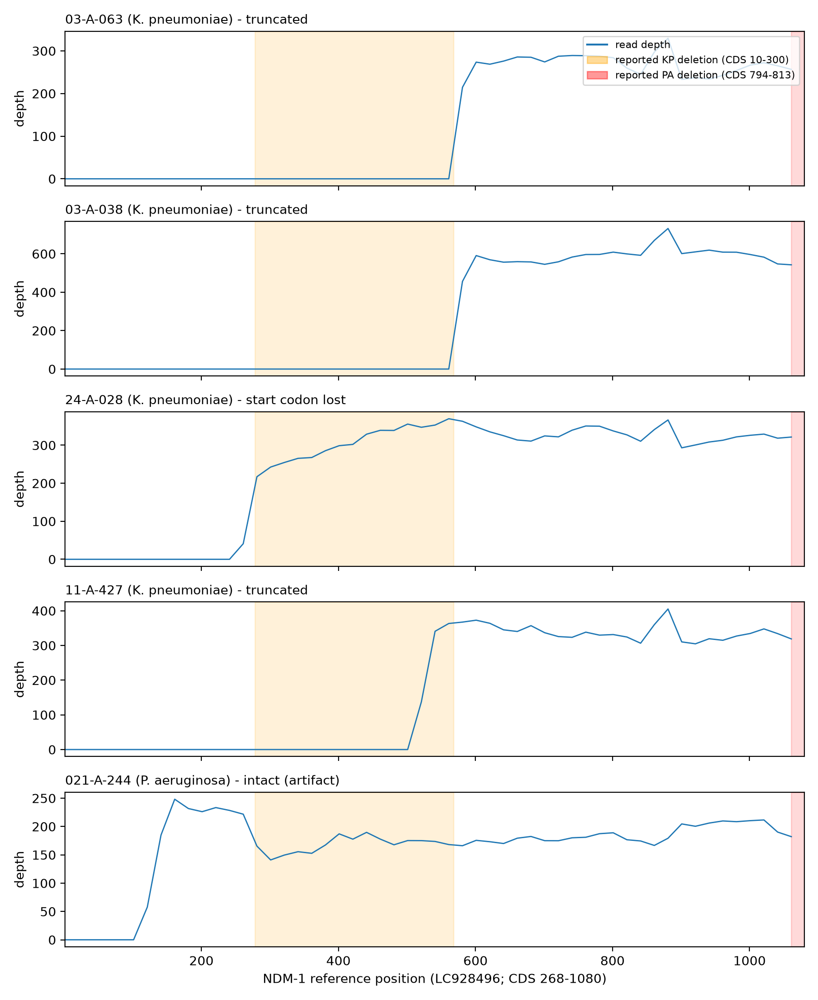
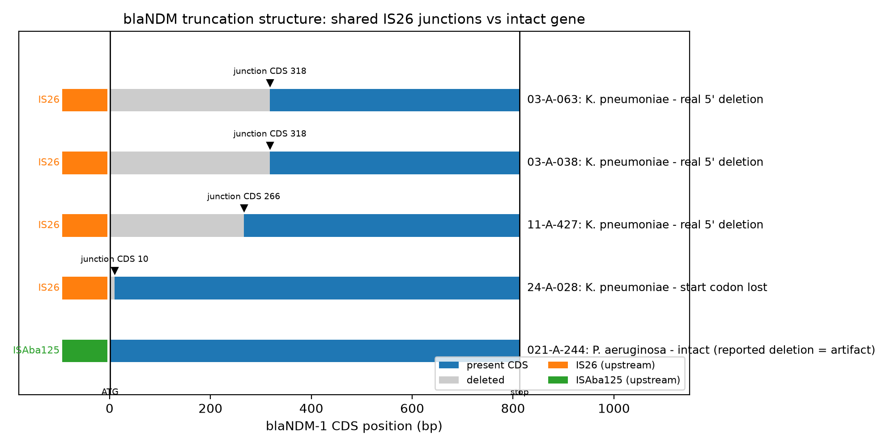
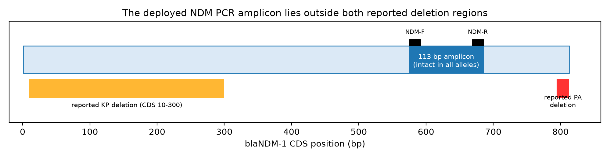
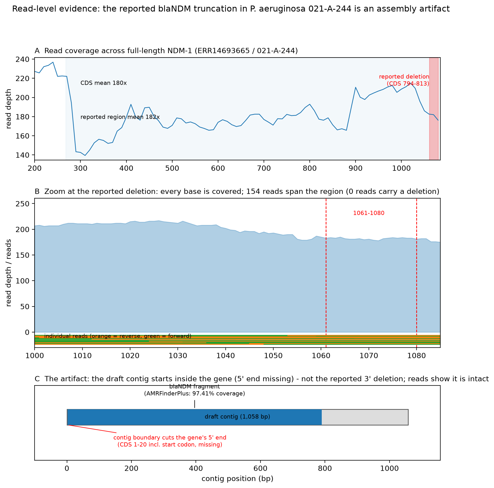

# When a "truncated" resistance gene isn't

**Read-level reanalysis of `blaNDM` in a Vietnamese lower-respiratory-infection cohort**

*TL;DR — We reanalysed the five public genomes behind a 2025 Vietnamese LRTI study.
Three K. pneumoniae isolates carry genuinely truncated `blaNDM` (IS26-mediated);
one lost only its start codon; and the reported P. aeruginosa "truncation" is an
assembly artifact — the gene is intact in the reads. The in-house NDM PCR cannot
tell the difference.*

---

## Background

Dung et al. (2025, *Annals of Clinical Microbiology and Antimicrobials*,
[doi:10.1186/s12941-025-00818-3](https://doi.org/10.1186/s12941-025-00818-3))
reported `blaNDM`-positive but ceftazidime-avibactam (CAZ-AVI) susceptible isolates
carrying a truncated `blaNDM`. The conclusion came from short-read genome
assemblies plus BLASTn — without read-level validation.

We asked a simple question: **do the raw reads actually support the truncations?**

## What we did

- Downloaded all five runs from ENA **PRJEB86571** with `nf-core/fetchngs`
  (NCBI SRA path; MD5-verified)
- Assembled with `nf-core/bacass` (Unicycler) and typed with **Kleborate** and
  **MOB-suite**
- Audited the gene at read level with a parallel Nextflow pipeline: per-base
  coverage, junction-spanning reads, deletion evidence, majority consensus
- Identified the mobile element against the **ISfinder** database

## Findings

| Isolate | Species | What the reads show |
|---|---|---|
| 03-A-063 | *K. pneumoniae* | real 5′ deletion (junction at CDS 317) |
| 03-A-038 | *K. pneumoniae* | real 5′ deletion (junction at CDS 317) |
| 11-A-427 | *K. pneumoniae* | real 5′ deletion (junction at CDS 265) |
| 24-A-028 | *K. pneumoniae* | **start codon lost** (IS26 joined at CDS 10) — not the reported Δ10–300 |
| 021-A-244 | *P. aeruginosa* | **intact full-length NDM-1** — reported truncation is an assembly artifact |

1. **The mechanism is named:** an **IS26-family (IS6) element** is joined to the 5′
   end of `blaNDM` in all four K. pneumoniae isolates, at four positions, with an
   identical junction sequence — a shared mobile-element event.
2. **Clonal spread, not independent acquisition:** all four K. pneumoniae are
   **ST16** — the clone previously associated with hospital outbreaks in southern
   Vietnam — with nearly identical plasmid profiles (IncFIB, IncFIB+IncFII,
   IncFII/rep_2183, IncX3/rep_1195).
3. **Allele correction:** the reported `blaOXA-48` is actually **`blaOXA-181`**,
   and it sits on a different plasmid from `blaNDM` in the draft assemblies.
4. **A diagnostic blind spot:** the deployed NDM PCR amplicon (CDS 574–686) is
   intact in both dead and live alleles — it cannot distinguish them.

## Figures

**Figure 1 — Coverage profiles across full-length NDM-1 for all five isolates**
(reported deletion regions shaded).

**Figure 2 — Junction structure:** IS26/ISAba125 elements and the deleted/present
CDS per isolate.

**Figure 3 — The assay blind spot:** the ref-29 PCR amplicon lies outside both
reported deletion regions.

**Figure 4 — The P. aeruginosa artifact:** uniform read coverage across the gene,
154 reads spanning the "deleted" region, zero deletion reads; the draft assembly's
partial call comes from a contig boundary cutting the gene's 5′ end.

## Why it matters

- Molecular detection of `blaNDM` should always be interpreted together with
  susceptibility testing — a positive PCR does not mean a functional enzyme.
- Assembly-based claims of gene truncation should be validated at read level;
  the same artifact that misled the original study is easy to reproduce.
- The IS26 mechanism and the ST16 clonal context add actionable information for
  Vietnamese hospital surveillance.

## Data and code

- Raw reads: ENA [PRJEB86571](https://www.ebi.ac.uk/ena/browser/view/PRJEB86571)
- Code and reproducible pipelines: this repository (`analysis/ndm_audit.nf`,
  `bin/`, pixi environments `default`, `analysis`, `plots`)
- Read-level audit results: `results/ndm_audit/`
