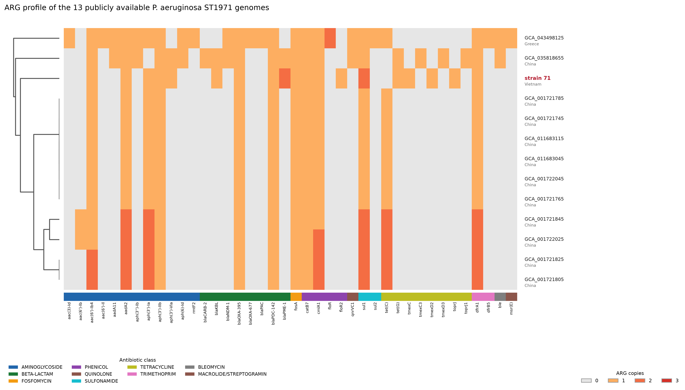

# Pseudomonas aeruginosa ST1971 AMR reanalysis

Reproducible single-sample reanalysis of the AMR results in:

> Nguyen QH, Nguyen TS, Tran TTT, et al. **Genomic characterization of an
> extensively drug-resistant high-risk *Pseudomonas aeruginosa* ST1971
> harbouring tmexCD2–toprJ2 from a Vietnamese patient with urinary tract
> infection.** *Journal of Global Antimicrobial Resistance* 48 (2026) 127–130.
> [doi:10.1016/j.jgar.2026.03.007](https://doi.org/10.1016/j.jgar.2026.03.007)

This is one self-contained solution in the
[vieomics/solutions](../README.md) repository. The step-by-step guide is this
README; the committed reference outputs are in `results/`, and the small
comparison tables are in `manifests/`.

The question: **does the public genome of *P. aeruginosa* strain 71 reproduce
the paper's resistome — 18 acquired ARGs (including `blaPDC-142`, `blaPME-1`
and `blaOXA-395`), the colistin-associated variants, and the
`tmexCD2–toprJ2` efflux cluster?**

## What is in this solution

```text
pa-st1971-amr-reanalysis/
├── README.md
├── pixi.toml / pixi.lock           # pinned environments
├── metadata/
│   ├── isolate.tsv                 # isolate, accession, phenotype
│   ├── data_availability.md        # why the raw reads are not used
│   └── paper_benchmark.tsv         # paper numbers and where to check them
├── bin/
│   ├── 00_check_env.sh             # verify every pixi environment
│   ├── 00_stage_databases.sh       # stage AMRFinderPlus + CARD from OmicsLab
│   ├── 01_download_genome.sh       # FASTA + deposited GenBank record
│   ├── 02_genome_qc.sh             # length, gaps and GC checks
│   ├── 03_annotate.sh              # GenBank proteins/GFF3 (or optional Bakta)
│   ├── 03_prepare_annotation.py    # GenBank -> protein FASTA + GFF3
│   ├── 04_mlst.sh                  # PubMLST sequence type
│   ├── 05_amrfinder.sh             # AMRFinderPlus ARGs + point mutations
│   ├── 06_rgi_card.sh              # CARD-RGI cross-check
│   ├── 07_vfdb.sh                  # ABRicate + VFDB
│   ├── 08_summarize.sh             # results/summary.md and .tsv
│   ├── 09_figures.py               # AMR gene map and class bar chart
│   ├── 10_manifest.sh              # manifests/ comparison tables
│   └── run_all.sh                  # run the whole workflow
├── analysis/arg_heatmap/           # 13-genome Fig. 1B-style ARG heatmap
├── results/                        # committed reference run (README inside)
│   └── heatmap/                    # 13-genome ARG matrix and figure
├── manifests/                      # committed summary tables (README inside)
├── data/                           # downloads (ignored)
├── db/                             # databases (ignored)
└── logs/                           # run logs (ignored)
```

## The data (one sample)

| Item | Value |
|---|---|
| Isolate | *P. aeruginosa* strain 71 |
| Genome | [CP196749.1](https://www.ncbi.nlm.nih.gov/nuccore/CP196749.1) / [NZ_CP196749.1](https://www.ncbi.nlm.nih.gov/nuccore/NZ_CP196749.1) |
| Size | 6,589,538 bp, one circular chromosome |
| GC | 66.17% |
| BioProject | [PRJNA1285411](https://www.ncbi.nlm.nih.gov/bioproject/PRJNA1285411) |
| BioSample | [SAMN49764163](https://www.ncbi.nlm.nih.gov/biosample/SAMN49764163) |
| Paper phenotype | XDR; imipenem 16, meropenem 32, colistin 32, levofloxacin >128, tigecycline 16 mg/L |
| Reported ST | ST1971 |

### Why the workflow starts from the assembly

The paper sequenced the isolate with Illumina NovaSeq and Oxford Nanopore
MinION and deposited the **finished chromosome**, not the raw reads. On
2026-11-18 the ENA/SRA read-run query for `PRJNA1285411` returned zero runs.
There are therefore no public FASTQ files to reproduce a read-level or hybrid
assembly.

This is not a shortcut around the biology. AMRFinderPlus, CARD-RGI, MLST and
VFDB work on nucleotide or protein sequences, so the resistome, sequence type
and virulence screens do not need the reads. The provenance and query are in
[`metadata/data_availability.md`](metadata/data_availability.md). If reads are
deposited later, the same AMR steps can be run on a new assembly.

## What the workflow does

```text
public genome CP196749.1
   │
   ├─ seqkit stats ................ length / GC / gap checks
   ├─ GenBank annotation .......... deposited proteins + GFF3
   │    (optional: Bakta 1.10.3)
   ├─ mlst 2.35.0 ................. PubMLST paeruginosa → ST1971
   ├─ AMRFinderPlus 4.0.19 ........ acquired ARGs + point mutations
   ├─ CARD-RGI 6.0.3 .............. second ARG caller (CARD 4.0.2)
   └─ ABRicate + VFDB ............. virulence-factor context
          │
          ├─ results/summary.md
          ├─ results/figures/*.png
          └─ manifests/*.tsv
```

Everything is installed by [pixi](https://pixi.sh). There is no Nextflow,
Docker or Apptainer step, and every command is a readable Bash or Python
script in `bin/`.

## Quick start

```bash
# 1. Install all environments (default, annotation, typing, resistome,
#    virulence and viz)
pixi install --all

# 2. Check the tools
bash bin/00_check_env.sh

# 3. Run the whole workflow
bash bin/run_all.sh
```

On an OmicsLab machine, `run_all.sh` stages the two large databases from the
public workspace before starting. On a laptop, the same script falls back to
the upstream AMRFinderPlus and CARD download commands.

The first run downloads:

| Resource | Size | Where |
|---|---|---|
| Chromosome FASTA | 6.4 MB | `data/CP196749.1.fasta` |
| Deposited GenBank record | 16 MB | `data/CP196749.1.gbff` |
| AMRFinderPlus database | ~236 MB | `db/amrfinder/` |
| CARD database | ~48 MB | `db/card/` |

A complete run takes a few minutes on 8 CPUs after the environments and
databases are staged. The default annotation mode does **not** download the
1.5 GB Bakta database.

## Step-by-step guide

The commands below are the same ones `run_all.sh` calls. Run them from
`pa-st1971-amr-reanalysis/`.

### 0. Install pixi and the environments

```bash
curl -fsSL https://pixi.sh/install.sh | bash
export PATH="$HOME/.pixi/bin:$PATH"
pixi install --all
bash bin/00_check_env.sh
```

`pixi` creates isolated environments from `pixi.toml` and records exact
versions in `pixi.lock`. No `conda activate`.

Why six environments? The paper pins versions that do not solve together —
RGI 6.0.3 pins an old Biopython, while Bakta and the current annotation stack
need newer packages. Separate environments keep each pin exact:

| Environment | Tools |
|---|---|
| `default` | seqkit, curl, coreutils, awk |
| `annotation` | Bakta 1.10.3, AMRFinderPlus 4.0.19, Biopython |
| `typing` | mlst 2.35.0 |
| `resistome` | CARD-RGI 6.0.3 |
| `virulence` | ABRicate 1.4.0 |
| `viz` | Python + matplotlib |

### 1. Stage the databases from the public OmicsLab workspace

The public workspace contains versioned reference databases under
`references/databases/`. The two this solution needs are
`amrfinderplus/2025-07-16.1` and `rgi/card_4.0.2`. No database API key is
required; `omx` uses your normal OmicsLab login context.

```bash
omx use -w c669cc81-d096-4679-a9a2-03329167b71f
omx ls references/databases

omx download references/databases/amrfinderplus/2025-07-16.1 \
  db/amrfinder -w c669cc81-d096-4679-a9a2-03329167b71f -y --threads 8
omx download references/databases/rgi/card_4.0.2 \
  db/card -w c669cc81-d096-4679-a9a2-03329167b71f -y --threads 8
```

Or simply:

```bash
bash bin/00_stage_databases.sh
```

The script records the versions it used in `db/database_sources.tsv`. If `omx`
is not installed, it runs `amrfinder_update` and downloads CARD from
`card.mcmaster.ca` instead.

> **Why not always download from upstream?** The OmicsLab copies are versioned,
> cached and much faster; the upstream CARD URL is a rolling `latest` endpoint.
> Record whichever versions you use — they affect the exact gene list.

### 2. Download and verify the genome

```bash
bash bin/01_download_genome.sh
```

The script downloads the FASTA (NCBI first, ENA as fallback), verifies the
expected MD5, and fetches the annotated GenBank record used in step 3. A
truncated download or an HTML error page is caught here, before any analysis.

Expected:

```text
data/CP196749.1.fasta: OK
[download] md5 OK: 0a70bcde2b23a14b74033a6da8078b24
```

Provenance is written to `data/download_info.txt`.

### 3. Check the FASTA

```bash
pixi run bash bin/02_genome_qc.sh
```

This runs `seqkit stats -a -T` and asserts:

| Check | Expected | Observed |
|---|---|---|
| sequences | 1 | 1 |
| length | 6,589,538 bp | 6,589,538 bp |
| gaps | 0 | 0 |
| GC | ~66.17% | 66.17% |

Outputs: `results/qc/seqkit_stats.tsv` and `results/qc/genome_check.tsv`.

### 4. Prepare the protein FASTA and GFF3

**Default — use the authors' deposited annotation (fast, no database):**

```bash
pixi run -e annotation bash bin/03_annotate.sh
```

`bin/03_prepare_annotation.py` reads `data/CP196749.1.gbff` and writes:

| File | What it is |
|---|---|
| `results/annotation/strain71.faa` | translated CDS, used by AMRFinderPlus |
| `results/annotation/strain71.gff3` | CDS coordinates, used to map hits back to the chromosome |
| `results/annotation/annotation_summary.tsv` | source and CDS count |

The committed run has 6,012 translated CDS. The GFF3 uses the same identifier
in `Name=` as the protein FASTA header, which is what AMRFinderPlus requires.

**Optional — reproduce the paper's Bakta 1.10.3 annotation:**

```bash
ANNOTATION_SOURCE=bakta pixi run -e annotation bash bin/03_annotate.sh
```

This downloads the Bakta **light** database (~1.5 GB; the full database is
39.4 GB) and writes the same two files from Bakta's output. The light database
is enough because AMRFinderPlus, CARD-RGI and MLST are run separately.

> The paper used Bakta 1.10.3. The default mode reuses the authors' own
> deposited annotation instead, so a beginner does not need a 1.5 GB download
> before reaching the AMR result. Both modes feed the same AMRFinderPlus and
> CARD-RGI steps.

### 5. Confirm the sequence type

```bash
pixi run -e typing bash bin/04_mlst.sh
```

Expected: scheme `paeruginosa`, ST `1971`, perfect allele match. The scheme
name is `paeruginosa`, not `pseudomonas`; `mlst --list` shows all names.
Outputs: `results/mlst/mlst.tsv` and `results/mlst/mlst_check.tsv`.

### 6. Call ARGs and point mutations with AMRFinderPlus

```bash
pixi run -e annotation bash bin/05_amrfinder.sh
```

The script runs AMRFinderPlus twice:

| Output | Contents |
|---|---|
| `results/amrfinder/amrfinder.tsv` | core AMR hits (the 18-ARG comparison) |
| `results/amrfinder/amrfinder_plus.tsv` | core + stress/virulence “plus” genes |
| `results/amrfinder/point_mutations.tsv` | every mutation considered by `mutation_all` |
| `results/amrfinder/amrfinder.database_version.txt` | database date |

How to read one row:

| Column | Meaning |
|---|---|
| `Element symbol` | short gene name, e.g. `blaPDC-142` (older versions: `Gene symbol`) |
| `Type` | `AMR`, `STRESS`, `VIRULENCE`, … (older versions: `Element type`) |
| `Class` / `Subclass` | β-lactam, aminoglycoside, etc. |
| `Method` | `ALLELEP`, `BLASTP`, `EXACTP`, `POINTP` |
| `% Coverage` / `% Identity` | how well the hit matches the reference |

> **Point-mutation trap:** `point_mutations.tsv` contains *every* variant
> considered, including wildtype rows marked `[WILDTYPE]`. A name appearing in
> that file does not mean the mutation was called. Check the `Element name`
> and `Method` columns.

### 7. Cross-check with CARD-RGI

```bash
pixi run -e resistome bash bin/06_rgi_card.sh
```

The script loads `db/card/card.json` into `./localDB` and runs RGI in contig
mode. Outputs: `results/rgi/strain71.txt` and `strain71.json`.

Useful columns: `Best_Hit_ARO` (gene), `Cut_Off` (Perfect/Strict/Loose),
`Best_Identities`, `Drug Class`, `Resistance Mechanism`, `AMR Gene Family`.

> RGI 6.0.3 rejects more than 8 threads even on larger machines; the script
> caps its own thread count. RGI reports intrinsic efflux pumps as well as
> acquired genes, so its 62 ARO names are not directly comparable to the
> paper's acquired-ARG count.

### 8. Virulence context with VFDB and ABRicate

```bash
pixi run -e virulence bash bin/07_vfdb.sh
```

This runs the VFDB nucleotide database locally with explicit thresholds
(`--minid 90 --mincov 50`). The paper used VFDB through the VFinder web
service; ABRicate is the local, scriptable equivalent. Output:
`results/virulence/vfdb.tsv`.

### 9. Build the summary

```bash
pixi run bash bin/08_summarize.sh
```

Outputs `results/summary.md` (human-readable tables) and
`results/summary.tsv` (one metric per row). The script is plain awk; read it as
a template for extracting columns without a parser library.

### 10. Draw the figures

```bash
pixi run -e viz python bin/09_figures.py
```

Outputs:

| Figure | What it shows |
|---|---|
| `results/figures/amr_gene_map.png` | acquired AMR genes along the 6.59 Mb chromosome |
| `results/figures/amr_classes.png` | AMR gene copies grouped by antibiotic class |

The map is built from the same `amrfinder.tsv` coordinates you can inspect by
hand; the `tmex`/`toprJ` points are highlighted.

### 11. Build the committed summary tables

```bash
bash bin/10_manifest.sh
```

This writes `manifests/`:

| File | Contents |
|---|---|
| `amr_genes.tsv` | unique AMRFinderPlus AMR symbols with coordinates |
| `point_mutations.tsv` | snapshot of the full `mutation_all` table |
| `rgi_calls.tsv` | unique CARD-RGI best hits |
| `vfdb_genes.tsv` | unique VFDB genes with hit counts |
| `paper_comparison.tsv` | paper vs observed values with notes |
| `software_versions.tsv` / `database_versions.tsv` | exact versions used |
| `reproducibility_manifest.json` | inputs, commands and SHA-256 checksums |
| `workflow_execution_report.md` | run summary and validation checklist |

See [`manifests/README.md`](manifests/README.md) for how to read each table.

## Key results from the reference run

The committed run is preserved in `results/` (see
[`results/README.md`](results/README.md) for the full provenance).

| Check | Observed | Paper |
|---|---|---|
| Genome size | 6,589,538 bp | 6,589,538 bp |
| ST | ST1971 | ST1971 |
| Named ARGs | `blaPDC-142`, `blaPME-1`, `blaOXA-395` | same genes |
| AMRFinderPlus AMR symbols | 23 including point calls; 19 non-point | 18 acquired ARGs |
| `tmexCD2–toprJ2` | `tmexC`, `tmexD2`, `toprJ` | present |
| Non-wildtype colistin call | `pmrB_V15I` | 10 variants reported |
| CARD unique ARO names | 62 (includes intrinsic pumps) | not reported |
| VFDB | 284 hits / 265 unique genes | 213 virulence factors |

The 19 non-point symbols include the partial `blaKBL` call; excluding it gives
the paper's 18. Do not lower thresholds to force the number to 18; record the
counting rule instead.

## Public-genome ARG heatmap (13 of 25)

The paper's Fig. 1B compares strain 71 with 24 public ST1971 genomes. Twelve of
those are deposited only as raw reads (`SRR...`), so they need assembly before
they can be plotted. The other twelve, plus strain 71 itself, are available as
`GCA` assemblies. Those **13 genomes** are plotted here:



The heatmap is an AMRFinderPlus presence/copy-number matrix, grouped by
antibiotic class and clustered by ARG profile. It is deliberately separate from
the single-sample workflow:

```bash
bash analysis/arg_heatmap/fetch_genomes.sh
pixi run -e annotation bash analysis/arg_heatmap/run_amrfinder.sh
pixi run -e viz python analysis/arg_heatmap/plot_heatmap.py
```

See [`analysis/arg_heatmap/README.md`](analysis/arg_heatmap/README.md) for the
accession list, the 12 missing `SRR` genomes and the caveats. This is **13 of
25**, not the paper's complete figure.

## Comparison with the paper

| Paper analysis | Here | Note |
|---|---|---|
| Complete genome, 6,589,538 bp | ✅ exact | public assembly, checksum verified |
| ST1971 | ✅ exact | same PubMLST scheme |
| Bakta v1.10.3 annotation | ⚙️ optional | default uses the authors' deposited GenBank annotation |
| AMRFinderPlus v4.0.19 ARGs + `mutation_all` | ✅ same tool version | database 2025-07-16.1 |
| CARD-RGI v6.0.3 | ✅ same tool version | CARD 4.0.2 |
| VFDB virulence factors | ✅ ABRicate + VFDB | paper used the VFinder web service |
| 18 acquired ARGs | ⚠️ 19 non-point symbols | counting convention differs |
| 213 virulence factors | ⚠️ 265 unique genes | newer VFDB release; ABRicate counts hits |
| Colistin mutations | ⚠️ `pmrB_V15I` called non-wildtype | other variants appear as wildtype rows |
| MobileElementFinder, PHASTER, ANI/SNP comparisons | ❌ not included | multi-genome or web-only analyses outside this AMR scope |
| Illumina + Nanopore hybrid assembly | ❌ not possible | raw reads are not public |

## What the paper did that this solution does not

The public chromosome supports the single-sample AMR reanalysis, but several
paper analyses need the reads, multiple genomes, or web services. The same list
is in the `scope` block of `manifests/paper_comparison.tsv`:

- **Clinical AST and MICs** — the 14-disc panel and MICs for imipenem,
  meropenem, colistin, levofloxacin and tigecycline. The paper values are
  recorded in `metadata/isolate.tsv`; they are not retested here.
- **Read QC and hybrid assembly** — FastQC, trimming, Unicycler 0.5.1,
  CheckM and QUAST 5.2.0. The raw Illumina/Nanopore reads are not public.
- **COGclassifier 1.0.5** — functional classification of the Bakta CDS.
- **Separate CARD/NDARO validation** — the paper validated calls against CARD
  and NDARO at ≥50% coverage and ≥90% identity. AMRFinderPlus already uses an
  NDARO-derived database, but there is no separate NDARO run here.
- **MobileElementFinder 1.1.2** — the paper reports 19 mobile genetic
  elements.
- **PHASTER 1.0.1** — the paper reports six prophages.
- **CRISPR arrays** — the paper reports three arrays.
- **Pathogenicity islands** — the paper reports seven islands.
- **Prophage context of `tmexCD2–toprJ2`** — the paper places the cluster
  between Bacteriophage Lily (`NC_028841`) and Escherichia phage
  `vB_EcoM-ep3` (`NC_025439`). The cluster is detected here, but the flanking
  prophages were not annotated.
- **ANI analysis** — 25 ST1971 genomes, six clusters at 99.90–99.99% ANI.
- **Core-genome SNP analysis** — Parsnp + Gubbins, 34–57 SNP differences.
- **GeneViewer / Proksee visualisation** — synteny plots and the circular
  chromosome map (Fig. 2); Fig. 1A (ANI heatmap) is also not reproduced.
- **Complete Fig. 1B heatmap** — the paper has 25 genomes. This solution has a
  Fig. 1B-style heatmap for the **13 genomes available as GCA assemblies**;
  the 12 `SRR`-only genomes need assembly first. See
  [`analysis/arg_heatmap/README.md`](analysis/arg_heatmap/README.md).

What *is* covered: genome integrity and size, ST1971, the acquired ARG calls,
the `mutation_all` point-mutation table, the `tmexCD2–toprJ2` cluster, VFDB
presence and categories, the exotoxin genotype, AMR gene maps and the
13-genome ARG heatmap.

## Important caveats

- **This is a genotype reanalysis, not a clinical study.** It does not retest
  susceptibility and cannot prove that a genotype causes the reported
  phenotype.
- **One sample, one genome.** There is no comparison panel here, so no
  transmission, outbreak or geographic-origin claim can be made.
- **The annotation source differs by default.** The committed run uses the
  authors' deposited GenBank proteins; the paper used Bakta 1.10.3. The
  optional Bakta mode reproduces the paper's annotation if you have the light
  database.
- **Database snapshots differ.** AMRFinderPlus 2025-07-16.1, CARD 4.0.2 and
  the 2026-Nov-18 VFDB release are newer than the paper's. Gene lists and
  counts are expected to differ at the margins.
- **`point_mutations.tsv` is not a call list.** It includes wildtype and
  considered variants. Read `Element name` and `Method` before reporting a
  mutation.
- **VFDB counts are hit counts.** ABRicate reports one row per database hit;
  the unique-gene count is smaller than the hit count, and neither is directly
  the paper's VFinder count.
- **CARD reports intrinsic resistance.** The `Mex`/`Opr` efflux systems are
  part of the chromosome, not newly acquired genes.
- **No mobile-element, prophage or comparative-genome analysis.** Those paper
  sections are outside this single-sample AMR solution.

## Environment and database notes

The analysis uses six pixi environments (see the table in step 0). The reasons
for the split are version pinning, not preference: RGI 6.0.3, Bakta 1.10.3,
AMRFinderPlus 4.0.19 and ABRicate 1.4.0 do not share one clean dependency
solve.

The AMRFinderPlus and CARD databases are staged from the public OmicsLab
workspace (`references/databases/`) by `bin/00_stage_databases.sh`. The
workspace ID is `c669cc81-d096-4679-a9a2-03329167b71f`; it is public and needs
no API key. If `omx` is unavailable, the script falls back to
`amrfinder_update` and the CARD `latest` archive.

The Bakta database is **not** part of the default path. If you enable
`ANNOTATION_SOURCE=bakta`, the script downloads the light database into
`db/bakta-light/` (git-ignored).

## Software versions

Main tools: seqkit 2.14.0, mlst 2.35.0, AMRFinderPlus 4.0.19, CARD-RGI 6.0.3,
ABRicate 1.4.0, Python 3.15 with matplotlib. Databases: AMRFinderPlus
2025-07-16.1 and CARD 4.0.2. The committed run used 8 CPUs / 16 threads
requested. Exact versions and checksums are in
`manifests/software_versions.tsv`, `manifests/database_versions.tsv` and
`manifests/reproducibility_manifest.json`.

## Troubleshooting

| Symptom | Fix |
|---|---|
| `pixi: command not found` | `export PATH="$HOME/.pixi/bin:$PATH"` |
| `omx: command not found` | Use a local machine; `00_stage_databases.sh` falls back to upstream downloads |
| ENA FASTA download times out | The script tries NCBI first and ENA as fallback; rerun it |
| `No valid AMRFinder database` | Run `bash bin/00_stage_databases.sh` |
| `If parameters --protein and --nucleotide are present then --gff must be present` | Use the GFF3 from step 4; do not drop `--gff` |
| `GFF file mismatch` | The GFF `Name=` must equal the protein FASTA id and the GFF seqid must equal the FASTA header id |
| `RGI ... num_threads illegal value` | RGI 6.0.3 accepts at most 8 threads; the script caps it |
| `RGI cannot load card.json` | Check `db/card/card.json`; use the staged CARD 4.0.2 copy |
| `abricate: database not found` | Run `pixi run -e virulence abricate --setupdb` |
| Bakta download stalls | Resume with `curl -C -` to `db/bakta-light/db-light.tar.gz`, then extract |
| Out of disk | Default path needs ~3 GB; the full Bakta database needs ~40 GB |
| Apple Silicon / macOS | Change `platforms` in `pixi.toml` to `osx-arm64`; some pinned Linux builds may not exist |

## Citations

1. Nguyen QH, et al. *J Glob Antimicrob Resist.* 2026;48:127–130.
   doi:10.1016/j.jgar.2026.03.007.
2. Bakta: Schwengers O, et al. *Microb Genom.* 2021;7(11):000685.
3. AMRFinderPlus: Feldgarden M, et al. *Sci Rep.* 2021;11:12728.
4. CARD-RGI: Alcock BP, et al. *Nucleic Acids Res.* 2023;51:D690–D699.
5. mlst: Seemann T. https://github.com/tseemann/mlst.
6. ABRicate/VFDB: Chen L, et al. *Nucleic Acids Res.* 2016;44:D694–D700.
